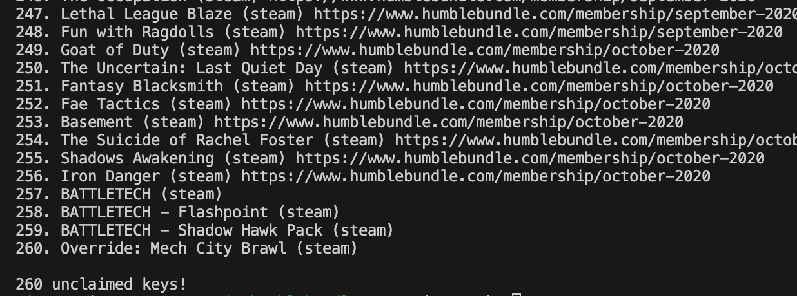
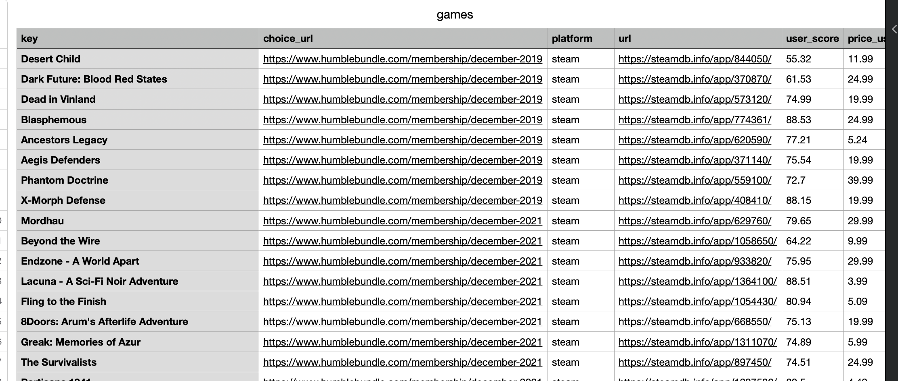

# humblebundle-games

Simple CLI tool to display all unclaimed keys you have on your humble bundle account.




```
Humble bundle keys

Usage: humblebundle-games [OPTIONS]

Options:
  -t, --token <TOKEN>        humblebundle.com Cookie header (`name=value; ...`), if not included tries to fetch cookies from firefox
  -f, --format <FORMAT>      format to output data in [default: text] [possible values: json, csv, text]
      --completions <SHELL>  Print shell completions for the given shell to stdout and exit [possible values: bash, elvish, fish, powershell, zsh]
  -h, --help                 Print help
  -V, --version              Print version
```

## Usage

Log in to humblebundle.com in Firefox and run the program, it will pick cookies from the browser.
Otherwise copy the `Cookie` request header of a humblebundle.com page from your browser's devtools and pass it with `--token`.
```
git clone https://github.com/BatteredBunny/humblebundle-games
cd humblebundle-games
cargo run --release
cargo run --release -- --token '{YOUR COOKIE HEADER}'
```


## Run with nix flake
```
nix run github:BatteredBunny/humblebundle-games -- --token '{YOUR COOKIE HEADER}'
```


## Output example

``
cargo run --release -- --format json
``

```json
[
    {
        "key": "Iron Harvest",
        "platform": "steam",
        "bundle": "January 2022 Humble Choice",
        "url": ""
    },
    {
        "key": "Space Haven",
        "platform": "steam",
        "bundle": "November 2026 Humble Choice",
        "url": ""
    }
]
```
